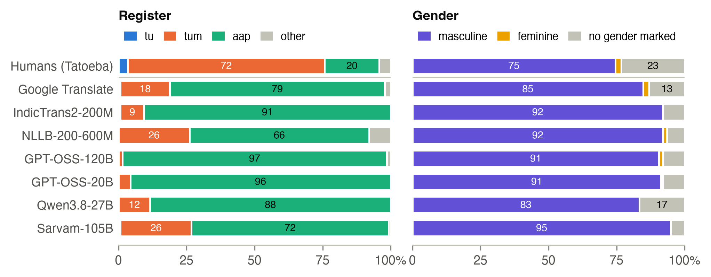

# Joint Resolution of Underspecified Attributes in English to Hindi Translation

Course project for *Essentials in Text and Speech Processing* (University of Zurich, fall 2026) by
Shivamm Warambhey, Manasi Agarwal and Manan Tejas Sodha.

English *you* marks neither register nor gender, but a Hindi translation has to mark both: the
pronoun तू, तुम or आप, and a masculine or feminine verb ending. We test which forms MT systems choose
when the English leaves both open, and whether they can produce a requested register and gender at
the same time. The hardest cases are verbs where a single ending carries both attributes, as in
*तुम कहाँ गई थी?* vs *आप कहाँ गई थीं?* ("Where did you go?", female addressee).

## Research questions

- **H1, defaults.** Without instructions, which register and gender do MT systems and LLMs produce?
- **H2, stereotypes.** Does the default gender shift with a stereotyped activity (*Will you cook?* vs
  *Will you drive?*), although it says nothing about the person addressed?
- **H3, control and interference.** When an LLM is asked for a register, a gender or both, does the
  requested form come out, and does steering one attribute disturb the other?
- **H4, metric sensitivity.** Do chrF, BLEU and COMET penalise a translation whose only error is the
  register or the gender?

## Main results

Three MT systems (Google Translate, IndicTrans2-200M, NLLB-200-600M) and four LLMs (GPT-OSS-120B,
GPT-OSS-20B, Qwen3.8-27B, Sarvam-105B), 7,624 translations in total, measured with the extractor
(98.4% accurate on 375 hand-labelled outputs). Full tables: [`outputs/results/`](outputs/results/).

- **H1:** every system addresses the reader with आप in 66–97% of the core sentences and uses masculine
  forms in 83–95%; feminine forms almost never appear. People translating comparable sentences on Tatoeba
  use तुम in 72% and आप in 20%.
- **H2:** Google Translate uses the feminine for 13 of 30 female-stereotyped sentences (Qwen 6, Sarvam 4),
  and no system ever does so for a neutral or male-stereotyped one.
- **H3:** asked for a register or a gender, the LLMs comply in 80–98% of outputs. Asking for both lowers
  the register only for GPT-OSS-120B (−5.4 points). Asked for तू, Qwen writes तुम in 55%. Stating the
  gender moves the register: Sarvam uses तुम for 51% of men but 20% of women.
- **H4:** a reference with only its gender flipped scores about as high as a correct MT output (chrF 78
  vs 80, COMET 95.7 vs 95.4), so sentence-level metrics cannot detect these errors.



## Repository

| folder | contents |
|---|---|
| [`dataset/`](dataset/) | The benchmark (222 English sentences, each with all six Hindi translations), the scripts that build and check it, and the **extractor** that reads register and gender off any Hindi sentence, with its evaluation and hand labels. See [`dataset/README.md`](dataset/README.md). |
| [`translation/`](translation/) | Scripts that translate the benchmark with three MT systems and four LLMs, with and without instructions. See [`translation/README.md`](translation/README.md). |
| [`analysis/`](analysis/) | The analysis of H1–H3 and H4, and the figures. See [`analysis/README.md`](analysis/README.md). |
| [`outputs/`](outputs/) | The translations (`translations/`) and the results (`results/`). See [`outputs/README.md`](outputs/README.md). |

## Getting the data

```bash
git clone https://github.com/Shivamm08/ETSP_Project.git
```

The benchmark is two UTF-8 CSV files:

| file | one row per | use it for |
|---|---|---|
| [`dataset/benchmark_v1.csv`](dataset/benchmark_v1.csv) | English sentence, with its six Hindi translations in `tu_m` … `aap_f` | MT input: the `english` column; rows with `split` = `core` for H1, H3 and H4, the frames (`frame_id`) for H2 |
| [`dataset/benchmark_v1_long.csv`](dataset/benchmark_v1_long.csv) | Hindi translation, labelled with `register` and `gender` | scoring MT outputs and testing the extractor |

GitHub shows both files as tables. Don't open and save them in Excel, which can corrupt the Hindi text.

## Setup

- The dataset scripts, the extractor and all unit tests need only Python 3.9 or newer.
- Translation, analysis and metrics need Python 3.12 and the packages in [`requirements.txt`](requirements.txt):

  ```bash
  conda create -n etsp python=3.12 && conda activate etsp
  pip install -r requirements.txt
  ```
- API keys go in `.env` (copy [`.env.example`](.env.example)); `.env` is never committed.

## Tests

60 unit tests, run from the repository root:

```bash
(cd dataset && python -m unittest discover -s tests)   # benchmark checks, normaliser, extractor (48)
python -m unittest discover -s translation/tests       # translation helpers (7)
python -m unittest discover -s analysis/tests          # statistics helpers (5)
ruff check .                                           # optional style check, configured in ruff.toml
```

## Reproducing the results

```bash
cd dataset
python scripts/build_dataset.py                 # check the benchmark, regenerate the long CSV
python scripts/evaluate_extractor.py --labelled validation/extractor_gold.csv   # extractor accuracy
cd ../translation
python run_llm.py --model gpt-oss-20b           # etc., see translation/README.md
cd ..
python analysis/analyze.py                      # H1-H3 tables and figures
python analysis/metrics_h4.py --comet           # H4 (COMET downloads a 2.3 GB model once)
```

The translations are in the repository, so the analysis can be rerun without any API key.

## Licence

The English sentences come from [Tatoeba](https://tatoeba.org) (CC BY 2.0 FR); see
[`dataset/README.md`](dataset/README.md#licence-and-attribution) for the attribution.
